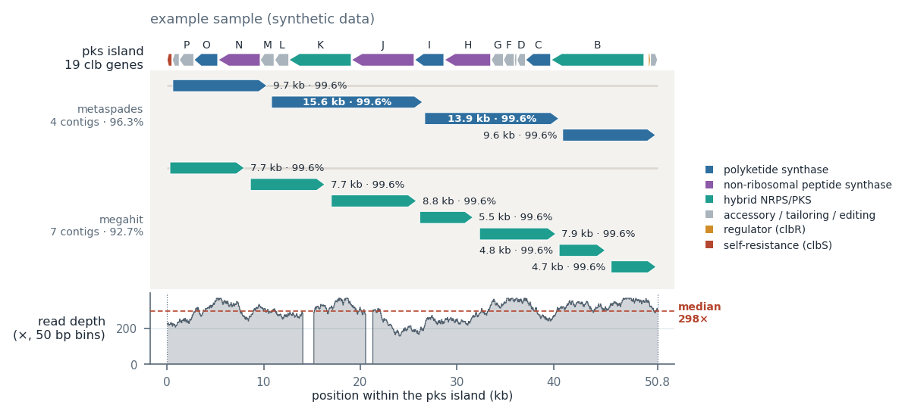
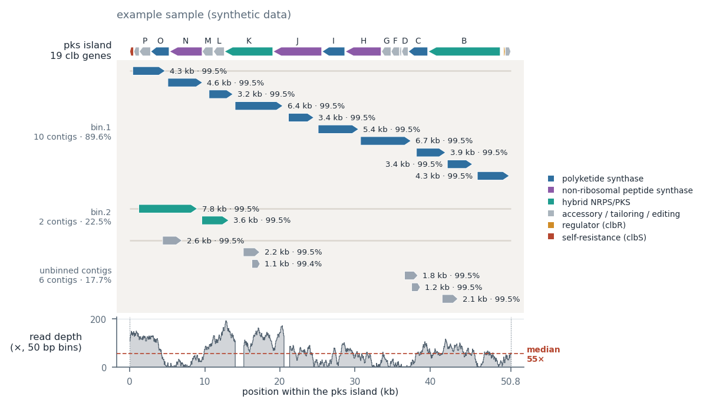

<h1></h1>

[](CHANGELOG.md)
[](https://github.com/AlexandrovLab/pksProfiler/actions/workflows/ci.yml)

**Profile the colibactin-encoding *pks* island in metagenomes and cancer sequencing data.**

pksProfiler is a Nextflow pipeline for detecting and characterizing the 19 *clb* genes that make up the *pks* island. These genes encode colibactin, a bacterial toxin that can damage human DNA.

It supports four assays, each with its own evidence report:

- **Gut metagenomes** — *clb* reads, genes and island breadth, plus reads per million host-depleted reads; optional community assembly and genome binning
- **Whole-genome sequencing (WGS)** — genomic *pks* evidence; short reads receive evidence tiers, and qualifying samples get targeted island reassembly
- **Whole-exome sequencing (WES)** — exploratory off-target *clb* DNA evidence
- **RNA-seq** — expressed *clb* sequence and expression breadth


## Quick start

Requires **Linux, Nextflow ≥24.10, Java 17+ on compute nodes, and Conda or Mamba**. Processes use pinned Conda environments; container profiles are not provided. Clone the repository and run from its directory. Human-depletion references must be supplied separately; the canonical bacterial reference and *clb* models are included.

**1. Prepare a CSV.** Use unique sample IDs in `patient`.

```csv
patient,fastq1,fastq2
SAMPLE_01,/data/SAMPLE_01_R1.fastq.gz,/data/SAMPLE_01_R2.fastq.gz
```

**2. Choose your sample mode.** One `--sample_type` per run — it is required and has no default.

| Your data | Use |
|---|---|
| Gut metagenome | `--sample_type metagenome` |
| Whole-genome sequencing | `--sample_type wgs` |
| Whole-exome sequencing | `--sample_type wes` |
| RNA-seq | `--sample_type rna` |

**3. Run it.** Replace the example paths with your own, and `<MODE>` with your choice above.

```bash
nextflow run main.nf -profile local \
  --sample samples.csv \
  --sample_type <MODE> \
  --input_data_type fastq \
  --hg38_db /refs/human-GRC-db.mmi \
  --t2t_phix_db /refs/human-GCA-phix-db.mmi \
  --outdir results
```

RNA-seq replaces `--hg38_db` with `--rna_splice_db`, because human depletion has to be
splice-aware; long reads take `--read_type ont|hifi` and their own indexes. Both are set out
in [Choose your sample mode](#choose-your-sample-mode) below.

**4. Open `results/cohort/pks_cohort_report.html`.** Check the QC table before interpreting missing or zero evidence. Add `-resume` to repeat a run using cached tasks — [what `-resume` does and does not reuse](docs/running/resume.md) matters when the pipeline version changed between runs.

<details>
<summary><strong>Other inputs: BAM, CRAM, single-end FASTQ</strong></summary>

For aligned BAM/CRAM input, use:

```csv
patient,alignment
TUMOR_01,/data/TUMOR_01.bam
TUMOR_02,/data/TUMOR_02.cram
```

- Set `--input_data_type auto` to accept BAM and CRAM in this sheet. The legacy `bam` column is also supported; a `cram` column is not.
- CRAM additionally requires `--cram_reference /refs/matching_reference.fa`.
- Do not mix alignment and FASTQ columns in one sheet. `auto` selects the route from the header, not separately for each row.
- For single-end FASTQ, omit `fastq2` or leave it empty. ONT/HiFi input must have one stream per sample.
- BAM/CRAM must have reference sequences in its header (`@SQ`). Convert unaligned BAMs to FASTQ first.
- Extraction retains primary unmapped reads. With `--extract_low_score_mapped auto` (default), a detected BWA-MEM alignment also contributes primary mapped reads with `AS < 30`. Use `on` or `off` to override.
- IDs must start with a letter or number and contain only letters, numbers, `.`, `_`, or `-`.

</details>

## Choose your sample mode

One `--sample_type` per run. It fixes which read technologies and which assembly steps are
available; input format and profiling method are separate choices. What each mode reports,
and how to read it, is in [Read the results](#read-the-results).

| Sample type | Read technology | Assembly support |
|---|---|---|
| **`metagenome`** | short only | Optional community assembly and genome binning |
| **`wgs`** | short, ONT, HiFi | Targeted island reassembly, short reads only, on by default |
| **`wes`** | short only | None |
| **`rna`** | short, ONT, HiFi | None |

Which host-depletion index each mode takes is in
[Reference downloads and databases](#reference-downloads-and-databases); the per-mode flags,
and what long reads do not support, are in
[Add the analyses you need](#add-the-analyses-you-need).

## Reference downloads and databases

Download references once into a permanent directory accessible to every compute node. The two shared folders below are the original project links recovered from the earlier documentation and RNA download script.

| Used for | Download or setup | Pipeline setting |
|---|---|---|
| **Short-read DNA host depletion**: metagenome, WGS, WES | [Original human-reference index folder](https://drive.google.com/drive/folders/1HounCjQE8pyve8hGBvhUVkvWHrWbpO35?usp=share_link): `human-GRC-db.mmi` (~9.1 GB, GRCh38.p14) and `human-GCA-phix-db.mmi` (~8.9 GB, T2T-CHM13v2.0; **contains no phiX despite the name** — [what each index holds](docs/host_depletion_references.md)) | `--hg38_db` and `--t2t_phix_db` |
| **Splice-aware short-read RNA host depletion** | [Shared RNA-reference folder](https://drive.google.com/drive/folders/10np5NSeAPRpHz1a22drGybs4enTP-OdR): `GRCh38.d1.vd1.splice_sr.mmi` and `gencode.v36.junctions.bed` | `--rna_splice_db` replaces `--hg38_db`; junction BED is optional; `--t2t_phix_db` is still required |
| **ONT/HiFi host depletion**: WGS/RNA only | Build indexes using the matching long-read preset, or provide FASTA; [preset and index instructions](docs/running/long_reads.md) | `--hg38_db_long` or `--rna_splice_db_long`, plus `--t2t_phix_db_long` |
| Optional extra human depletion | Supply your own combined human-pangenome index or directory of indexes; retain the source/build manifest | `--pangenome_db` |
| Bacterial reference and *clb* models | [IHE3034 reference/index](indices/GCF_000025745.1/), [annotation](ref/annotations/IHE3034.clbA-clbS.gff), and [HMM provenance](ref/hmm/PROVENANCE.md) are included | Defaults are supplied by the pipeline |

**Verify a downloaded index** against the audited release: [`conf/databases.tsv`](conf/databases.tsv)
records a content checksum of each database's release-defining key file (for the two indexes above, the
index header — checked with [`scripts/describe_minimap2_index.py`](scripts/describe_minimap2_index.py)),
and every run recomputes a file-listing fingerprint and prints frozen/CHANGED in `RUN_REPORT.txt`.

<details>
<summary><strong>Download and verify the RNA references</strong></summary>

The repository helper downloads the shared files and checks fixed MD5 values. It requires `gdown`; see the [download script](scripts/download_rna_references.sh).

```bash
bash scripts/download_rna_references.sh /refs/rna_grch38_splice_sr_gencode_v36
```

Use the downloaded files with:

```bash
--sample_type rna \
--rna_splice_db /refs/rna_grch38_splice_sr_gencode_v36/GRCh38.d1.vd1.splice_sr.mmi \
--rna_junctions_bed /refs/rna_grch38_splice_sr_gencode_v36/gencode.v36.junctions.bed \
--t2t_phix_db /refs/human-GCA-phix-db.mmi
```

The shared RNA index was built with minimap2 `splice:sr` from GRCh38.d1.vd1; junctions come from GENCODE v36. **Do not substitute the standard DNA index or reuse this short-read splice index for ONT/HiFi.** Binary indexes retain their build settings. Keep source assemblies and build records when rebuilding human indexes.

</details>

### Optional taxonomy and MAG databases — downloads

| Database | Download/setup | Needed for |
|---|---|---|
| KrakenUniq Microbial, 8 August 2023 | [Database file](https://genome-idx.s3.amazonaws.com/kraken/uniq/krakendb-2023-08-08-MICROBIAL/database.kdb) and [supporting archive](https://genome-idx.s3.amazonaws.com/kraken/uniq/krakendb-2023-08-08-MICROBIAL/kuniq_microbialdb_minus_kdb.20230808.tgz); unpack together. The database file alone is approximately 535 GiB. [Other builds](https://benlangmead.github.io/aws-indexes/k2/) | `--kraken_db`; taxonomy also needs a matching `--bracken_read_length` model |
| GTDB-Tk R232 | [Release directory](https://data.gtdb.ecogenomic.org/releases/release232/) and [repository download/checksum helper](scripts/download_mag_databases.sbatch) | `--gtdbtk_db` (directory) for MAG taxonomy |
| CheckM2 | [Database record](https://zenodo.org/records/14897628) and [repository download/checksum helper](scripts/download_mag_databases.sbatch) | `--checkm2_db` (the `uniref100.KO.1.dmnd` file) for MAG quality |
| geNomad database v1.9 | [Database record](https://zenodo.org/records/14886553) and [repository download/checksum helper](scripts/download_genomad_database.sbatch) | `--genomad_db` (directory) for prophage analysis |

All three MAG databases are required when `--enable_mags true`. The download helpers above are Slurm scripts: adapt their scheduler/environment settings to your site. Record database releases; a directory name alone does not establish which build it contains. The pipeline's [database manifest](conf/databases.tsv) records the audited builds.

## Add the analyses you need

| Analysis | Switch or setting | Availability |
|---|---|---|
| Alignment profiling | `--profiling_method bowtie2` (default) | All supported sample/read combinations; uses minimap2 for long reads |
| Nucleotide HMM profiling | `--profiling_method hmm` or `both` | HMM-only: metagenomes; `both`: all supported sample/read combinations |
| Targeted island reassembly | `--tumor_targeted_assembly true` (default) | Short-read WGS; `broad_island` and `extensive_island` by default |
| Community assembly and genome binning | `--enable_mags true` | Short-read metagenomes |
| Prophage and flanking-gene context | Included with MAG analysis | Metagenome genome bins |
| Seven-locus *E. coli* strain typing | On with MAG analysis; disable using `--enable_strain_typing false` | Recovered genome bins; not WGS contigs |
| Island-read taxonomy | `--pks_taxa true` | Short reads with alignment profiling |
| Whole-community taxonomy | `--pks_community_taxa true` | Short reads with the balanced prefilter |
| Locus-specificity challenge **(experimental)** | `--pks_locus_specificity true` | Short-read WGS/metagenomes with alignment profiling |
| Candidate-organism comparison **(experimental)** | `--pks_carrier_attribution true` | All four short-read sample modes with alignment profiling |

**Experimental lanes.** `--pks_locus_specificity` (V8a) and `--pks_carrier_attribution`
(V8b) are off by default and their thresholds are uncalibrated placeholders. Read their
verdicts as a prompt to investigate, not as results to report, and do not use one to
overturn a tier. See [docs/running/specificity.md](docs/running/specificity.md).

<details>
<summary><strong>Metagenome genome binning: databases, outputs, and interpretation</strong></summary>

Add these flags to the metagenome quick-start command:

```bash
--enable_mags true \
--gtdbtk_db /db/gtdbtk \
--checkm2_db /db/checkm2/uniref100.KO.1.dmnd \
--genomad_db /db/genomad
```

MEGAHIT assembles the community; MetaBAT2 groups contigs into metagenome-assembled genomes (MAGs). CheckM2 estimates genome quality, GTDB-Tk assigns taxonomy, and Prokka/geNomad support gene and prophage annotation.

Every recovered bin, plus the pooled **unbinned** contigs, is aligned to the canonical island. Genome-level locus evidence is separate from sample read evidence. Protein HMM hits alone do not establish a *pks*-positive genome. An unbinned hit is not an additional positive genome or an identified organism.

No contigs or bins means no reconstruction, not demonstrated biological absence; the files to start from are listed under [Read the results](#read-the-results). Add `--save_intermediates true` to publish assembly and bin FASTAs; these are not retained in the results directory by default.

Community tables describe prophages, nearby integrase/tRNA features, and co-occurring bins. They support hypotheses about interaction or mobility, not proof of physical proximity, transfer, or prophage induction. Default strain typing uses the *E. coli* Achtman scheme and requires enough assembled sequence to recover its loci.

</details>

<details>
<summary><strong>WGS, WES, RNA, and long-read settings</strong></summary>

**Short-read WGS:** change `--sample_type` to `wgs`. Targeted assembly recruits island/flank reads and recovers mates from the full host-depleted stream, then compares MEGAHIT and metaSPAdes reconstructions. For read profiling alone, set `--tumor_targeted_assembly false`.

**WES:** use `--sample_type wes`. Optionally supply `--wes_capture_bed /refs/targets.bed` for input-alignment capture QC. FASTQ input has no input-alignment capture metrics. WES evidence depends on capture and off-target sampling; a negative does not establish absence.

**RNA:** use `--sample_type rna` and replace `--hg38_db` with `--rna_splice_db /refs/GRCh38.splice_sr.mmi` (or FASTA). Optional settings are `--rna_junctions_bed /refs/junctions.bed` and `--rna_library_type polyA|total|unknown`. Human depletion is splice-aware. RNA evidence reflects expression and library preparation, not genomic island completeness or demonstrated toxin activity. `clb_transcripts_detected` counts genes with ≥3 assigned reads by default, not reconstructed transcripts.

**ONT/HiFi:** add `--read_type ont` or `hifi` to a WGS/RNA run. Supply `--hg38_db_long` (WGS) or `--rna_splice_db_long` (RNA), plus `--t2t_phix_db_long`. Use FASTA or indexes built for the appropriate long-read preset; short-read indexes are not interchangeable. Long-read targeted reassembly, MAG analysis, Bracken taxonomy, `--pks_locus_specificity`, and `--pks_carrier_attribution` are not supported.

</details>

<details>
<summary><strong>Alignment, HMMs, prefiltering, and optional read checks</strong></summary>

**Alignment:** short reads map to the full IHE3034 reference genome with Bowtie2, followed by MAPQ ≥40 filtering and assignment to *clbA–clbS*. Long reads use minimap2 and featureCounts long-read mode. Gene counts are read counts, not fragment counts.

**HMMs:** read profiling uses nucleotide models and `nhmmscan` (default E-value `1e-10`). `both` keeps alignment and HMM counts separate. HMM-only metagenome runs have no alignment coverage, `read_evidence.tsv`, or alignment-dependent optional checks; MAG analysis remains available independently. `--hmm_chunking true` enables chunked scanning. The protein HMM search in MAG analysis is a separate step.

**Prefilter:** `--prefilter_mode auto` becomes `balanced` for a metagenome supplied with `--kraken_db`, and `off` otherwise. Balanced mode uses KrakenUniq to retain the selected bacterial group and DIAMOND to rescue *clb*-like reads from the rejected set; rescue must remain enabled. It does not narrow assembly input or the metagenome RPM denominator. Set `--prefilter_mode off` explicitly if you want unfiltered profiling.

**Taxonomy:** `--pks_taxa true` describes island-aligned reads. `--pks_community_taxa true` describes the complete non-host classification report and requires balanced prefiltering. Both require `--kraken_db` and a matching `--bracken_read_length` model. These outputs are **read-level taxonomic support, not carrier attribution**. Whole-community taxonomy can run with HMM-only profiling; island-read taxonomy cannot.

**Locus specificity:** compares supporting reads with a *pks*-negative decoy panel. It distinguishes retained support, cross-mapping, insufficient power, and incomplete measurement.

**Carrier attribution:** compares supporting reads with a *pks*-positive carrier panel and reports ambiguity at strain/genus level. It identifies the best-supported candidate within that panel; it does not physically link the island to a reconstructed genome. Both optional checks need prepared panels: see [panel setup](docs/running/specificity.md).

</details>

## Read the results

**[Open the example HTML report](https://htmlpreview.github.io/?https://github.com/AlexandrovLab/pksProfiler/blob/main/examples/results/cohort_report/pks_cohort_report.html)**

Explore a synthetic WGS cohort before running the pipeline. This example illustrates the report layout and evidence displays; it is not a validation dataset or an example of every supported mode.

[HTML source](examples/results/cohort_report/pks_cohort_report.html) · [Report table (TSV)](examples/results/cohort_report/pks_cohort_report.tsv) · [QC table](examples/results/cohort_report/pks.qc.summary.tsv)

In a completed run, open `results/cohort/pks_cohort_report.html`. Keep it with its `by_sample` tree — figure panels use relative links.

Each sample gets `figures/island_reconstruction.pdf` beside `circos.pdf`: genes, the contigs that rebuild the island, and read depth, on one axis.

<details>
<summary><strong>WGS</strong> — metaSPAdes vs MEGAHIT; agreement is the evidence</summary>



Drawn automatically. Contigs carry length and identity; row labels give contig count and island share. Filtered at ≥90% identity, MAPQ ≥20.

</details>

<details>
<summary><strong>Metagenome</strong> — one row per bin, unbinned pool last in grey</summary>



Island sequence in a bin points to a carrier; in the unbinned pool it shows presence only. The MAG lane is optional, so run this one by hand:

```bash
python3 scripts/plot_island_reconstruction.py --mode metagenome \
    --sample-dir results/by_sample/<sample> \
    --gff ref/annotations/IHE3034.clbA-clbS.gff \
    --out island_reconstruction.pdf --also png
```

</details>

Both examples use synthetic data. Full description: [docs/output.md](docs/output.md).

| Start here | What to look for |
|---|---|
| `cohort/pks_cohort_report.html` | Cohort overview, mode-specific evidence, and enabled analyses |
| `cohort/pks.master_summary.tsv` | One sample per row, joining the enabled stages |
| `cohort/qc/pks.qc.summary.tsv` | Read attrition, missing stages, and terminal status |
| `cohort/gene_counts/pks.gene.counts.{align,hmm}.txt` | One *clb* gene per row, one sample per column; methods stay separate |
| `by_sample/<sample>/` | Evidence, alignments, assemblies, genome bins, and optional checks |
| `RUN_REPORT.txt` | Run settings, references, software versions, and provenance |

**Metagenome abundance** is `pks_reads × 1,000,000 / host_depleted_reads`. The denominator is the complete final host-depleted stream, before optional profiling prefiltering. A zero denominator is reported as `NA`.

**A missing result is not a negative.** Check QC and stage status first. For short WGS, QC's `completed_negative` includes `localized_indeterminate`; inspect `read_evidence.tsv` to distinguish weak evidence from zero reads.

### What “untiered” means

**Measurements are reported, but no short-read WGS evidence category is assigned.** It does not mean negative, failed, or low confidence.

| Data | How to read the result |
|---|---|
| Short-read WGS | Reads, genes, and island coverage determine an evidence tier such as `multi_gene` or `broad_island`. |
| Long-read WGS | Counts and coverage are reported without those tiers: a long read covers far more sequence than a short read, so the same cutoffs are not directly transferable. |
| Metagenomes | Read counts, genes, coverage, and reads per million are reported without WGS tiers. Genome bins receive a separate assessment of assembled-locus evidence if MAG analysis is enabled. |
| WES | Off-target DNA measurements are reported without WGS tiers; capture efficiency changes what is sampled. |
| RNA | Expression measurements are reported without WGS tiers; RNA abundance and library preparation do not measure genomic island completeness. |

The output uses the literal value `untiered` in `read_evidence.tsv` for metagenomes and long-read WGS. WES/RNA instead have their own evidence files. HMM-only profiling produces HMM counts without an alignment-based read-evidence file.

<details>
<summary><strong>Short-read WGS tiers and mode-specific files</strong></summary>

Each positive WGS tier requires **all three thresholds**. Breadth is the fraction of the canonical 50,768-bp island covered at ≥1×.

| Tier | Assigned reads | Genes detected | Island breadth |
|---|---:|---:|---:|
| `extensive_island` | ≥100 | ≥10 | ≥15% |
| `broad_island` | ≥30 | ≥8 | ≥7.5% |
| `multi_gene` | ≥5 | ≥3 | ≥1% |
| `localized_indeterminate` | ≥1; below `multi_gene` criteria | — | — |
| `negative` | 0 | 0 | — |

These are operational evidence tiers, not calibrated probabilities or clinical diagnoses. Short WGS also reports fragment/deduplication sensitivity checks without replacing the primary raw-read tier.

| Mode | Per-sample evidence file |
|---|---|
| WGS | `read_evidence.tsv` (tiered only for short reads) |
| Metagenome | `read_evidence.tsv` (`untiered`, plus RPM) |
| WES | `wes_evidence.tsv` |
| RNA | `rna_evidence.tsv` |

The four read-evidence files above require alignment profiling; HMM-only runs instead produce HMM counts. Targeted WGS results are in `contigs/final_evidence/final_pks_evidence.tsv`. Metagenome genome results are in `genomes/pks_mag_summary.tsv`; status is in `genomes/mag_status.tsv`.

</details>

## Software

Nextflow creates the task-specific environments from [`conda_envs/`](conda_envs/). Keep the environments and work directory available when resuming. Use `-profile mamba` for Mamba or replace `local` with your scheduler profile; see [`conf/`](conf/).

<details>
<summary><strong>Pinned environment versions</strong></summary>

| Environment | Pinned packages |
|---|---|
| `checkm2_env.yml` | python 3.12.15, checkm2 1.1.0, diamond 2.2.8, tensorflow 2.19.1, scikit-learn 1.9.1, numpy 2.5.4 |
| `fastp_env.yml` | fastp 1.3.7 |
| `fastplong_env.yml` | fastplong 0.7.1 |
| `genomad_env.yml` | python 3.13.16, genomad 1.12.0, keras 3.15.1, numpy 2.5.4, mmseqs2 18.8cc5c, aragorn 1.2.41 |
| `gtdbtk_env.yml` | python 3.13.16, gtdbtk 2.7.2, prodigal 2.6.3, hmmer 3.4, pplacer 1.1.alpha19, fastani 1.34, skani 0.4.0, fasttree 2.2.0 |
| `krakenUniq_bracken_env.yml` | python 3.12.15, krakenuniq 1.0.4, bracken 3.1p1, krakentools 1.2.1, pandas 2.3.0, matplotlib 3.9.4 |
| `megahit_env.yml` | megahit 1.2.9 |
| `metabat2_env.yml` | metabat2 2.18 |
| `minimap2_env.yml` | minimap2 2.31, samtools 1.24, htslib 1.24 |
| `mlst_env.yml` | python 3.11.9, mlst 2.35.0, blast 2.16.0, any2fasta 0.8.1 |
| `pks_align_env.yml` | python 3.12.15, pandas 2.3.3, bowtie2 2.5.5, minimap2 2.31, samtools 1.24, htslib 1.24, bedtools 2.31.1, subread 2.1.1, deeptools 4.0.0, r-base 4.5.3, r-circlize 0.4.18, r-cairo 1.7_0, r-dplyr 1.2.1 |
| `pks_hmm_env.yml` | python 3.10.22, pandas 2.3.3, hmmer 3.4, seqtk 1.5, seqkit 2.14.0 |
| `prefilter_env.yml` | python 3.11.9, krakenuniq 1.0.4, diamond 2.2.8 |
| `prokka_env.yml` | prokka 1.15.6, blast 2.16.0, barrnap 1.10.6, aragorn 1.2.41, hmmer 3.4, infernal 1.1.5, minced 0.4.2 |
| `samtools_env.yml` | python 3.10.22, samtools 1.24, htslib 1.24 |
| `targeted_alignment_env.yml` | minimap2 2.31, python 3.11.9, matplotlib-base 3.10.3 |
| `targeted_recruit_env.yml` | python 3.11.9, bowtie2 2.5.5 |
| `targeted_spades_env.yml` | python 3.11.9, spades 4.3.0 |

</details>

## Further documentation

- **Inputs:** [BAM/CRAM](docs/running/bam.md) · [FASTQ](docs/running/fastq.md)
- **Modes:** [WES/RNA](docs/running/wes_rna.md) · [Long reads](docs/running/long_reads.md) · [HMMs](docs/running/hmm.md)
- **Assembly:** [WGS reassembly](docs/running/assembly.md) · [Metagenome binning](docs/running/mags.md) · [Community context](docs/running/community_context.md) · [Strain typing](docs/running/strain_typing.md)
- **Read analyses:** [Taxonomy](docs/running/taxonomy.md) · [Prefilter](docs/prefilter.md) · [Specificity and attribution](docs/running/specificity.md)
- **Reference:** [Outputs](docs/output.md) · [HPC](docs/hpc.md) · [Glossary](docs/glossary.md) · [HMM model provenance](ref/hmm/PROVENANCE.md) · [Tool citations](CITATIONS.md)

<!-- Documentation reviewed against the v1.0.0 tree (6 November 2026). Structure and flow follow the October 2026 documentation review; facts re-verified against this revision. -->

## Citation

A manuscript is in preparation. Until then cite the software — GitHub and Zenodo both read
[`CITATION.cff`](CITATION.cff), so the "Cite this repository" button produces a correct
reference. Record the release tag or commit you ran, and cite the underlying tools your run used
([`CITATIONS.md`](CITATIONS.md)).

The biological premise — that colibactin-producing *E. coli* leave a distinctive mutational
signature in colorectal cancer — rests on Pleguezuelos-Manzano *et al.* and
Dziubańska-Kusibab *et al.*, both *Nature* 2020.

## License

[BSD 2-Clause](LICENSE).
